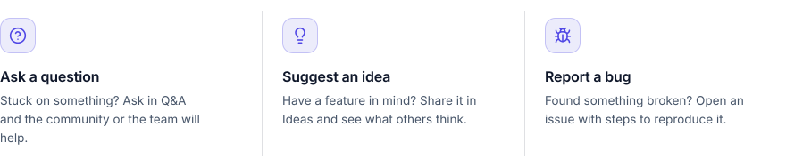

<picture>
  <source media="(prefers-color-scheme: dark)" srcset="assets/banner-dark.svg">
  
</picture>

<a href="https://github.com/ioncoden/community/discussions">
<picture>
  <source media="(prefers-color-scheme: dark)" srcset="assets/discuss-dark.svg">
  
</picture>
</a>&nbsp;&nbsp;<a href="https://github.com/ioncoden/community/issues/new/choose">
<picture>
  <source media="(prefers-color-scheme: dark)" srcset="assets/bug-dark.svg">
  
</picture>
</a>

 
 

<picture>
  <source media="(prefers-color-scheme: dark)" srcset="assets/features-dark.svg">
  
</picture>

## Before you post

- Search [discussions](https://github.com/ioncoden/community/discussions) and [issues](https://github.com/ioncoden/community/issues) first. Your question may already be answered.
- Keep to one topic per post, with a clear title.
- Be kind. Everyone here is building something.

## Reporting a bug

Tell us what you did, what you expected, and what happened instead. Add your browser, operating system, and a screenshot if you can. The bug report form asks for each of these.

## Staying up to date

Release notes are in the [changelog](https://github.com/ioncoden/changelog#readme). To try the platform, [open ioncode](https://ioncoden.web.app).

<picture>
  <source media="(prefers-color-scheme: dark)" srcset="assets/footer-dark.svg">
  
</picture>
